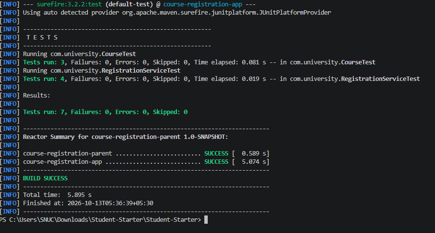
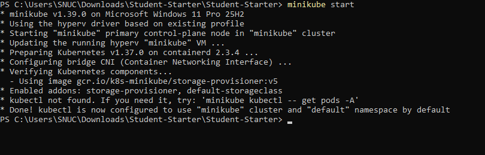
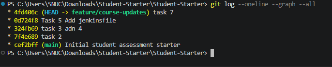
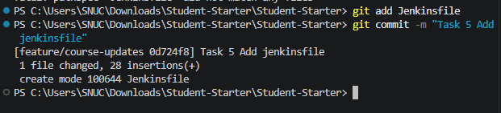
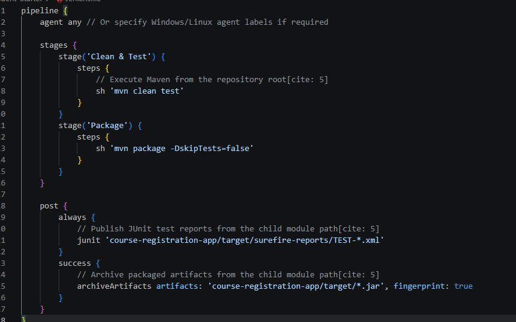
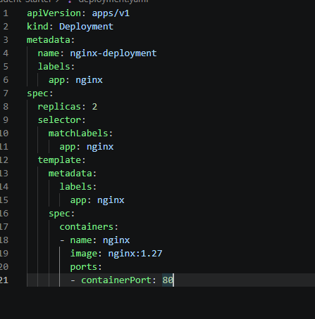
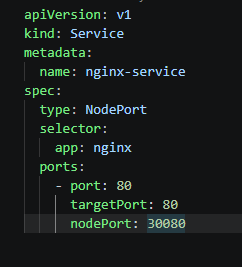
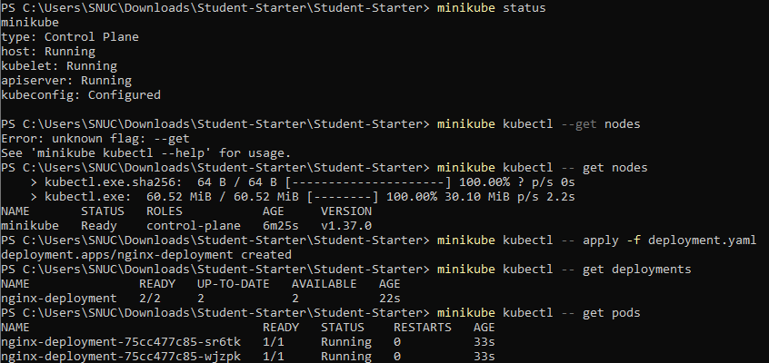
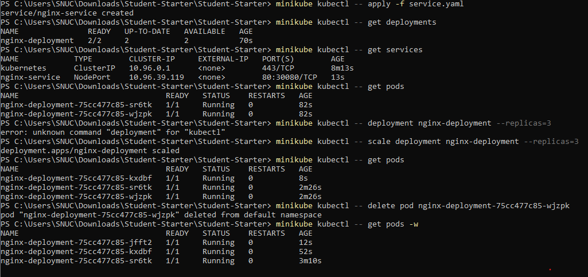

# Devops Lab Exam - CIA - 2

**[Aadhithya VM]**
**[23011102002]**

## 1. Setup and Execution Instructions

Here are the commands required to build, test, package, and deploy the application locally:

**Build, Test, and Package (Maven):**

```bash
mvn clean test
mvn package
```



**Deploy (Kubernetes):**

```bash
# Start Minikube
minikube start

kubectl apply -f deployment.yaml
kubectl apply -f service.yaml
```



## 2. Git Evidence

All development was done in a feature branch, isolated from `main`.

- **Feature Branch Name:** `feature/registration-fix`
- **Change Summary:** Refactored the project into a Maven parent/child multi-module structure, fixed the capacity boundary defect (`>` to `>=`), implemented the 5-course registration limit, created a Jenkins pipeline, and added Kubernetes manifests for Minikube.

**Commit History:**

```
4fd406c (HEAD -> feature/course-updates) task 7
0d724f8 Task 5 Add jenkinsfile
324fb69 task 3 adn 4
7f4e689 task 2
cef2bff (main) Initial student assessment starter
```





## 3. Maven Configuration & Build Evidence

I split the single-module project into a clean Parent-Child architecture.

- **Parent-Child POM Structure:** The root `pom.xml` is the parent (`course-registration-parent`, `pom` packaging) and lists `course-registration-app` under `<modules>`. It defines the Java 17 and UTF-8 properties, and uses `<dependencyManagement>` (JUnit Jupiter 5.10.0, test scope) and `<pluginManagement>` (compiler plugin 3.11.0, surefire plugin 3.2.2) to centralize versions. The child POM (`course-registration-app`, `jar` packaging) inherits from the parent and declares `junit-jupiter` without a version or scope, so upgrading a dependency is a one-line change in the parent.

- **Build/Test Results:** `mvn clean test` from the root builds the parent first and then the child. All 13 JUnit 5 tests pass (3 in `CourseTest`, 10 in `RegistrationServiceTest`) with 0 failures, 0 errors and 0 skipped, ending in `BUILD SUCCESS`.


## 4. Jenkins Pipeline Explanation

I wrote a `Jenkinsfile` to handle Continuous Integration. It has two stages, `Clean & Test` (`mvn clean test`) and `Package` (`mvn package -DskipTests=false`), plus a `post` section.

- **Test Reporting:** The `post { always { ... } }` block runs the `junit` step on `course-registration-app/target/surefire-reports/TEST-*.xml`. Maven runs from the root but surefire writes its reports in the child module, so the path points there. Because it is in `always`, the results are published whether the build passes or fails, and Jenkins shows which tests failed.

- **Preventing Bad Packages and Artifacts:** If a JUnit test fails, `mvn clean test` exits with a non-zero status, so the `Clean & Test` stage fails. Pipeline stages fail fast, so the `Package` stage never runs and no JAR is built. `archiveArtifacts` sits in `post { success { ... } }`, which only runs when the whole pipeline succeeds, so a failing build never archives a JAR. As a second safeguard, `mvn package` re-runs the tests.



## 5. Kubernetes Deployment Evidence

The application is deployed on a local Minikube cluster using standard YAML manifests.

**1) deployment.yaml** (2 replicas of `nginx:1.27`, label `app: nginx`)



**2) service.yaml** (NodePort service `nginx-service`, port 80 exposed on node port 30080)



**kubectl outputs:**

```
> minikube kubectl -- get deployments
NAME               READY   UP-TO-DATE   AVAILABLE   AGE
nginx-deployment   2/2     2            2           22s

> minikube kubectl -- get services
NAME            TYPE        CLUSTER-IP     EXTERNAL-IP   PORT(S)        AGE
kubernetes      ClusterIP   10.96.0.1      <none>        443/TCP        8m13s
nginx-service   NodePort    10.96.39.119   <none>        80:30080/TCP   13s
```



**Scaling and Self-Healing Evidence:**

I scaled the deployment from 2 to 3 replicas with `kubectl scale deployment nginx-deployment --replicas=3`, and a third Pod (`kxdbf`) started within seconds. Then I deleted pod `nginx-deployment-75cc477c85-wjzpk`. The Deployment's ReplicaSet detected that the actual count had dropped below the desired 3 and immediately created a replacement, `jfft2`, restoring 3 running Pods without any manual action.



## 6. Change Summary and Limitations

- **Defect Correction:** In `RegistrationService`, the capacity check was `currentEnrollment > capacity`, so a course that was exactly full still accepted one more student. I changed it to `>=`, so the last seat can still be taken but a full course rejects new registrations. `Course.incrementEnrollment()` also no longer exceeds capacity.

- **Assigned Change Request (Question Set B - maximum number of registered courses):** A student may register for no more than five courses, even when the credit limit has not been reached. I added `MAX_COURSES = 5` and a check `student.getRegisteredCourses().size() >= MAX_COURSES` in `RegistrationService.register()`. It is an extra check placed alongside the existing ones; the active-course, capacity, duplicate, prerequisite and credit-limit checks are unchanged.

  | Acceptance criterion | How it is met / tested |
  |---|---|
  | Sixth course is rejected | `testSixthCourseRegistrationRejected` |
  | Fifth course is allowed when other rules pass | `testFifthCourseRegistrationAllowed` |
  | A rejected sixth attempt does not change the course list, total credits or the course's enrollment | Asserted in `testSixthCourseRegistrationRejected` (5 courses, 15 credits, enrollment 0). The student is at 15 of 20 credits, so only the new rule can cause the rejection. |
  | Existing rules still work | `testValidRegistrationSucceeds`, `testInactiveCourseRejected`, `testMissingPrerequisiteRejected`, `testCompletedPrerequisiteAllowsRegistration`, `testDuplicateRegistrationRejected`, `testCreditLimitStillEnforcedBelowFiveCourses`, plus the capacity tests `testLastRemainingSeatIsAllowed` and `testFullCourseRejectsRegistration` |

- **Modified Files:**
  - `pom.xml` (Root, rewritten as parent POM)
  - `course-registration-app/pom.xml` (New)
  - `course-registration-app/src/main/java/com/university/RegistrationService.java`
  - `course-registration-app/src/main/java/com/university/Course.java`
  - `course-registration-app/src/test/java/com/university/RegistrationServiceTest.java` (Tests for the capacity fix, the 5th/6th course boundaries, and the existing rules)
  - `Jenkinsfile` (New)
  - `deployment.yaml` (New)
  - `service.yaml` (New)
  - `Student.java` and `CourseTest.java` were only moved into the child module.

- **Known Limitations:**
  - The Kubernetes deployment pulls a stock Nginx image rather than a Docker image of our Java application, because the project builds a library JAR with no `main` method and no Dockerfile.
  - The Jenkins pipeline was not run on a Jenkins server for this evidence, so the failing-test behaviour described in section 4 is how the pipeline is designed to work, not something I demonstrated. There is also no deploy stage, so the Minikube deployment is a manual step.
  - If compilation fails, no test XML is produced and the `junit` step would error; `allowEmptyResults: true` would avoid that.
  - Minikube is a local single-node cluster and is not industry standard for production.
